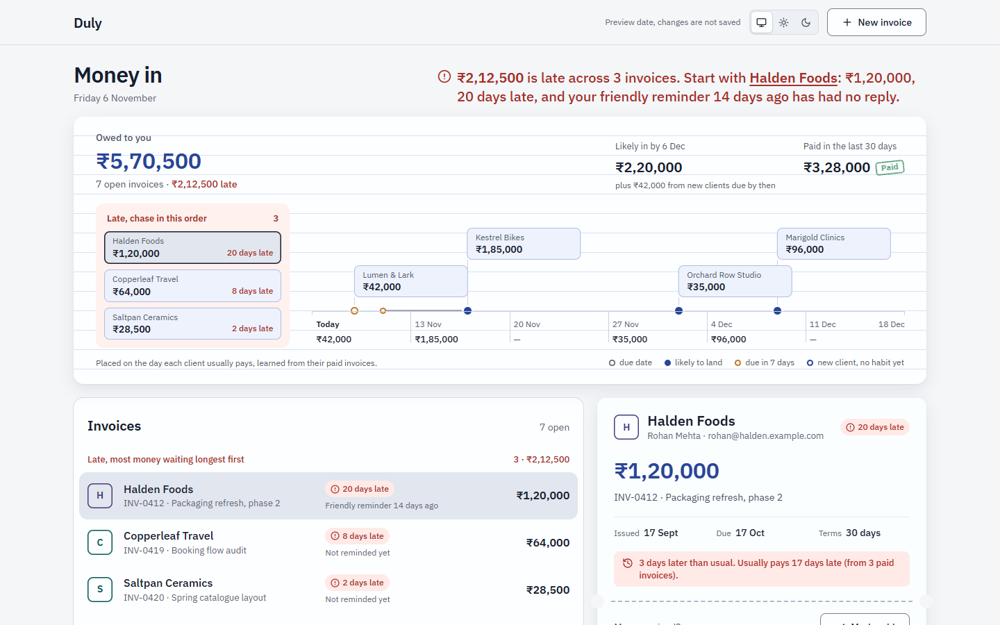
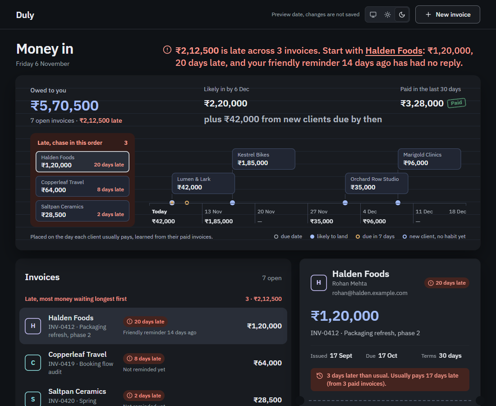
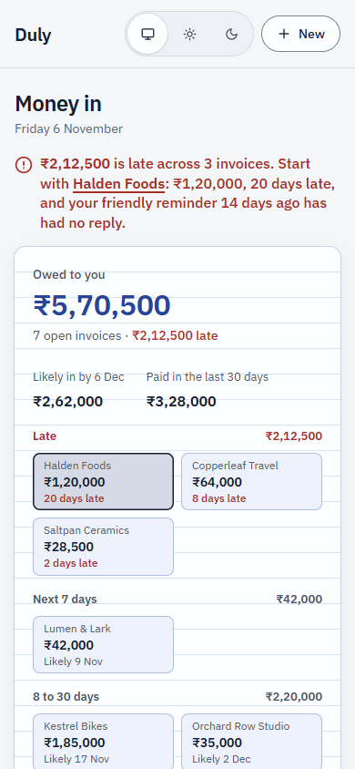

# Duly

A receivables desk for freelancers: who owes what, what is late, when the money is likely to land (predicted from each
client's own paying habit), and a reminder to send in the right tone. Duly never moves money.

- **Who it's for:** freelancers and small studios who invoice clients and lose track of late payments.
- **Status:** prototype, paused after three review rounds. The 22-step end-to-end click-through test passes.
- **Privacy:** data stays in the browser on your device. Sample clients and contacts are invented
  (`.example.com` addresses).
- **Built with:** Vite, React 18, TypeScript; Python + Playwright for the click-through test.

## Screenshots



| Dark theme | Phone |
|---|---|
|  |  |

## Run it

```bash
cd app
npm install
npm run dev          # http://localhost:5240/#/app
```

- `?today=2026-11-06` pins the date and turns saving off (used by every test and review).
- Click-through test (dev server running): `pip install playwright && python tests/flows.py http://localhost:5240/`

## How it was designed

- `design-notes/direction.md`: brief, job to be done, user.
- `design-notes/direction-v2.md`: principles, category audit, candidate directions and the chosen one.
- `design-notes/reviews.md` and `design-notes/review/r2`, `r3`: every review round, finding and fix.

## Licence

MIT. See [LICENSE](LICENSE).
